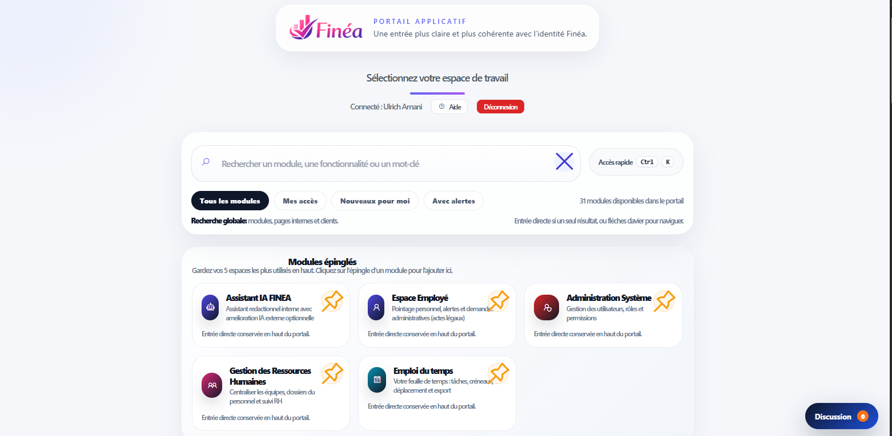

# Bien demarrer avec {{APP_NAME}}

## Pourquoi cette application existe

{{APP_NAME}} est l espace principal de travail dans lequel vous retrouvez plusieurs fonctions utiles au quotidien.

L objectif est simple :

- mieux organiser le travail ;
- mieux suivre les demandes ;
- mieux partager les informations ;
- mieux retrouver les documents et les actions en cours.

## Ce que veut dire {{APP_NAME}}

{{APP_NAME}} porte une promesse simple : rendre la gestion plus fluide, plus moderne et mieux maitrisee.

Vous pouvez retenir l idee suivante :

- Finance pour la rigueur et le pilotage ;
- innovation pour la modernite ;
- fluidite pour des parcours plus simples au quotidien.

## Phrase de marque a retenir

{{APP_SLOGAN}}

## Ce que raconte le logo

Le logo de {{APP_NAME}} doit exprimer une application de gestion fiable, moderne et facile a utiliser.

Ses codes visuels racontent :

- la performance et la croissance ;
- la validation et la fiabilite ;
- la fluidite de circulation de l information ;
- une image plus premium et technologique.

## Ce que vous y gagnez

En maitrisant {{APP_NAME}}, vous pouvez :

- faire vos demandes plus facilement ;
- suivre leur avancement ;
- savoir ou trouver l information ;
- eviter les doubles saisies ;
- gagner du temps sur les recherches et relances.

## Ce qu il faut retenir

Chaque module a un role precis. Par exemple :

- Espace employe pour vos demandes et votre suivi personnel ;
- Mes tâches pour l execution et la coordination ;
- Documentation & Archives pour les documents de reference ;
- Formation pour apprendre a utiliser les modules.

## Ce que le centre Formation permet maintenant

Le centre Formation ne sert plus seulement a afficher un texte statique.

Il permet maintenant de :

- choisir un module de formation dans une liste claire ;
- ouvrir les guides disponibles pour ce module ;
- basculer entre plusieurs documents sans quitter le centre Formation ;
- exporter le guide ouvert en PDF ;
- exporter tout un module en PDF pour le partager ou l imprimer ;
- consulter le contenu Markdown du guide quand on veut relire la version source.

Pour un utilisateur, cela veut dire qu il devient plus simple de retrouver un support, de l emporter en PDF et de relire un module complet sans naviguer dans plusieurs espaces.

## Comment utiliser simplement Formation

1. entrer dans Formation depuis le portail ;
2. choisir le module qui vous concerne ;
3. ouvrir le guide adapte a votre besoin ;
4. lire le contenu directement a l ecran ;
5. exporter en PDF si vous avez besoin d un support a conserver.

## Bon usage

- commencer par le bon module plutot que parcourir tous les guides ;
- utiliser l export PDF pour partager une reference stable ;
- revenir dans Formation quand une procedure change ou quand un nouveau module apparait ;
- signaler un guide incomplet si une etape utile manque.

## Bon reflexe des le depart

- passer par l application plutot que par des circuits informels ;
- verifier regulierement les informations qui vous concernent ;
- utiliser le bon module pour la bonne action ;
- signaler rapidement tout blocage ou incomprehension.

## En resume

{{APP_NAME}} est un outil de maitrise du travail collectif. Plus vous le maitrisez, plus vos actions sont fluides, visibles et faciles a suivre.

## Preparation des futures illustrations

Les futures illustrations viendront montrer de facon simple comment un utilisateur entre dans {{APP_NAME}}, se repere dans les modules et commence a travailler efficacement.

