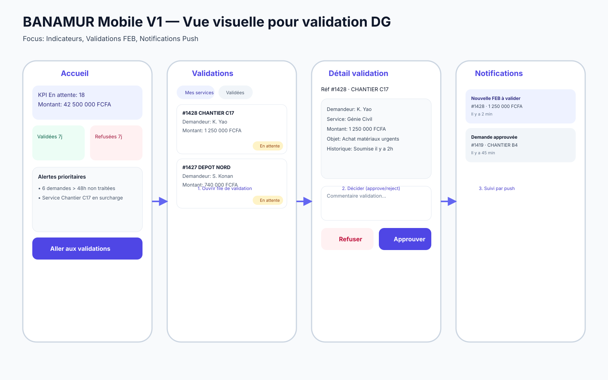

# Pack de validation DG — Version mobile Flutter

## Vision en une phrase
Une application mobile Flutter orientée **pilotage et décision**: voir les indicateurs financiers clés, valider rapidement les FEB, et agir via alertes push.

## Ce que le DG doit valider

1. **Périmètre V1**
   - Indicateurs
   - Validations
   - Notifications push
2. **Bénéfice métier attendu**
   - Décisions plus rapides
   - Réduction du backlog de validations
   - Visibilité en temps réel des montants en attente
3. **Planning cible**
   - 6 à 8 semaines pour une V1 opérationnelle

## Maquette visuelle synthèse

## Narratif de démonstration (5 minutes)

- Écran 1 (Accueil): vue KPI immédiate (attente, montants, alertes).
- Écran 2 (Validations): file priorisée des FEB à traiter.
- Écran 3 (Détail): décision approuver/refuser avec commentaire.
- Écran 4 (Notifications): suivi des événements et relance rapide.

## Message de décision

Si validé, on lance une V1 ciblée avec ROI rapide plutôt qu’un portage complet de l’ERP.
